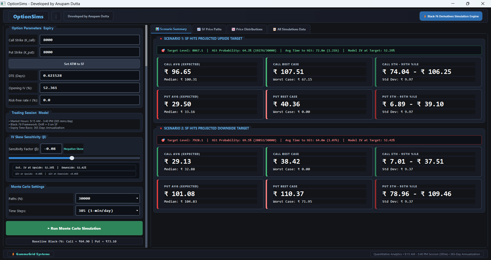
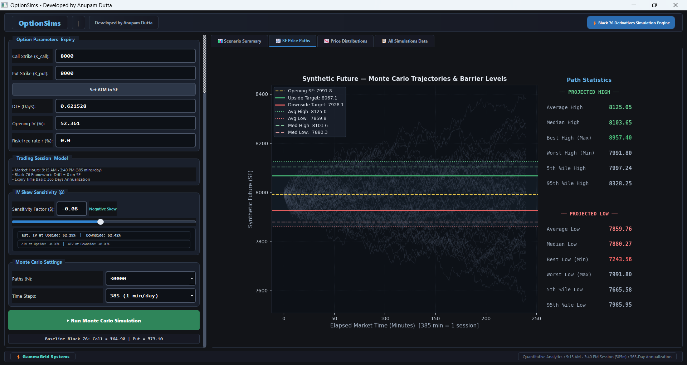
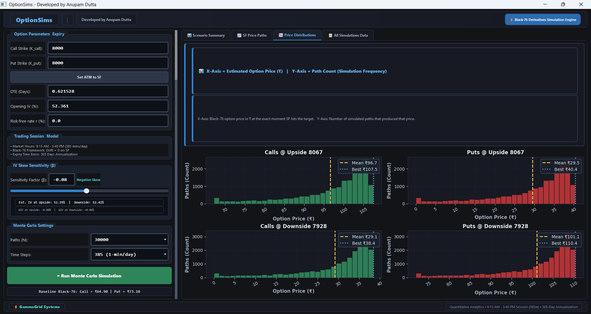

# OptionSims

An options simulation terminal built by Anupam Dutta (GammaGrid Systems) in Python and PyQt5.

OptionSims models European call and put option valuations under Synthetic Future (SF) target price barriers using the Black-76 pricing model and vectorized intraday Monte Carlo path simulations.

---

## Visual Interface

### 1. Scenario Summary Dashboard
Evaluation of projected Upside and Downside targets, hit probabilities, average time-to-hit, and price percentiles.



### 2. Monte Carlo Price Paths
Vectorized simulation of price trajectories reaching target barrier levels.



### 3. Price Distributions
Frequency histograms of option prices evaluated at the exact point of target hit.



---

## Features

- **Synthetic Future (SF) Basis**: Models the underlying forward directly from option chain parity.
- **Black-76 Valuation**: Pricing for European options with intraday time decay and intrinsic expiration convergence.
- **Dynamic Skew Adjustment**: Bidirectional slider and input box to test volatility sensitivity across target expansions.
- **Session Mechanics**: Configured for standard trading hours (9:15 AM to 3:40 PM, 385 minutes/day) and 365-day year conventions.
- **Multi-Strike Testing**: Independent Call and Put strike inputs with single-click ATM alignment.
- **Export Capabilities**: View detailed path statistics in a dedicated table and export records to CSV.

---

## Setup and Execution

### Prerequisites
- Python 3.9 or higher

### Installation
```bash
pip install -r requirements.txt
```

### Launch
```bash
python app.py
```

---

## Testing
Run automated unit and synchronization tests:
```bash
python test_app.py
python test_slider_sync.py
python verify_labels.py
```

---

## Contact
- **Author**: Anupam Dutta
- **Research Lab**: [anupamdutta.github.io](https://anupamdutta.github.io)
